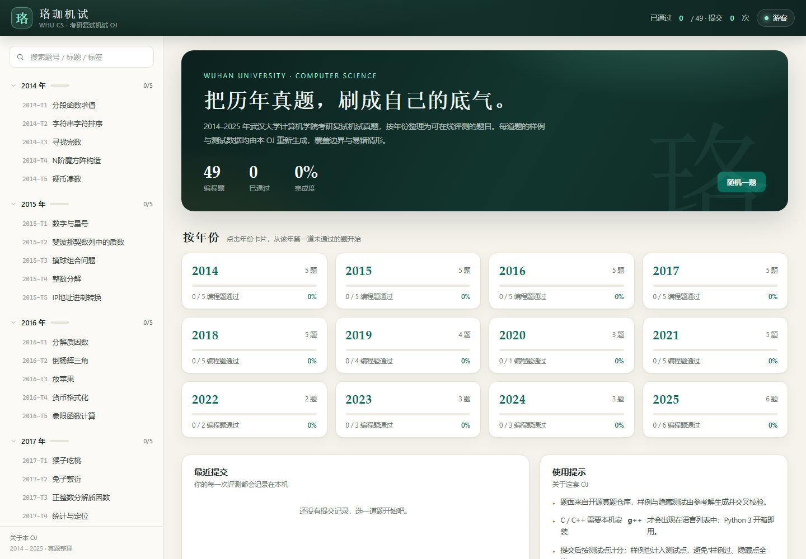
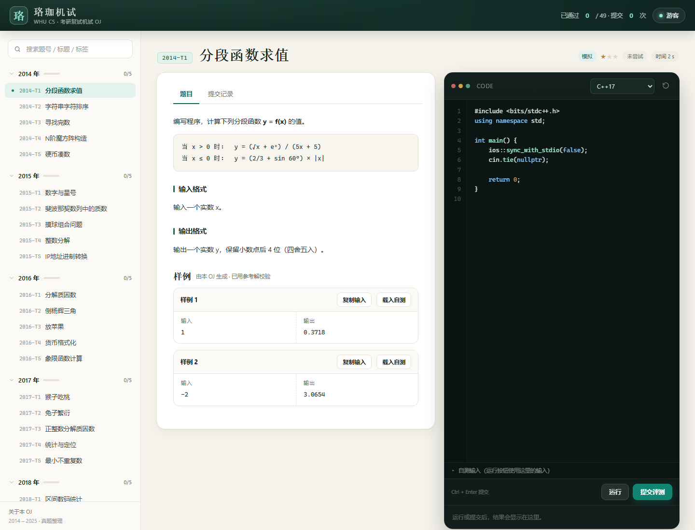

# 珞珈机试 OJ

武汉大学计算机学院考研复试机试真题（2014–2025）的本地在线评测系统。题目按年份整理，包含题面、样例、隐藏测试与评测机；所有样例与测试数据均由参考解生成并校验。

> 题面整理自开源仓库 [XUAHW/WHU-CS-KaoYan-Machine-Test](https://github.com/XUAHW/WHU-CS-KaoYan-Machine-Test)，仅用于学习交流。

## 预览





## 快速开始

环境要求：**Python 3.10+**（零第三方依赖）。C / C++ / JavaScript 为可选项。

```bat
:: Windows：双击 run.bat，或在本目录执行
run.bat
```

```bash
# macOS / Linux
chmod +x run.sh
./run.sh
# 或者
python3 server.py --open
```

也可以使用 Docker（镜像内已带 g++ / gcc / nodejs）：

```bash
docker compose up -d --build
```

启动后访问 <http://127.0.0.1:8765>。停止服务按 `Ctrl+C`（Docker 用 `docker compose down`）。

也可以手动指定端口：

```bash
python server.py --port 9000
```

## 功能

- **按年份刷题**：2014–2025 共 51 条题目，其中 49 道编程题、2 道主观题；侧栏按年份折叠，显示完成进度。
- **在线评测**：提交代码后逐个测试点运行，显示 AC / WA / TLE / RE / CE / OLE、通过数与耗时。
- **自测运行**：把样例或自定义输入载入“自测输入”，只运行不记录。
- **本地记录**：提交记录、代码、昵称均保存在本机；每道题的代码按语言分别自动保存。
- **搜索与筛选**：按题号、标题、标签搜索；年份卡片显示完成度。
- **离线可用**：不依赖任何 CDN，前端与题目数据全部随项目分发。

## 题目与数据

| 年份 | 题数 | 年份 | 题数 |
| --- | --- | --- | --- |
| 2014 | 5 | 2020 | 3（1 编程 + 2 主观） |
| 2015 | 5 | 2021 | 5 |
| 2016 | 5 | 2022 | 2 |
| 2017 | 5 | 2023 | 3 |
| 2018 | 5 | 2024 | 3 |
| 2019 | 4 | 2025 | 6 |

- 每道编程题提供 1–2 组展示样例，以及 4–14 个隐藏测试点。
- 样例同样计入测试点，避免“样例通过、隐藏点全错”的假象。
- 数据覆盖边界：空输入、全负、单元素、重复值、最大规模、无解等情况。
- 2017-T3 与 2016-T1 题面相同，按原仓库保留为两条独立记录。

### 数据是怎么生成的

`content/sol_*.py` 中为每道题保存了参考解、展示样例与测试生成器。执行：

```bash
python build.py
```

会完成：

1. 从 `source/README.md` 解析题面与元数据；
2. 用参考解计算样例输出，并核对原题面给出的样例；
3. 生成隐藏测试并计算期望输出；
4. 写出 `problems/*.json`（公开题面）与 `tests/*.json`（隐藏数据）。

评测机只读取 `problems/` 与 `tests/`，运行服务时不需要参考解。

部分复杂题目另有独立暴力校验脚本：`tools/verify_all.py`、`tools/verify_t2.py`。

## 语言支持

| 语言 | 条件 | 说明 |
| --- | --- | --- |
| C++17 | 检测到 `g++` | 自动搜索 PATH、Dev-C++ 的 TDM-GCC-64、MSYS2、MinGW、LLVM 等常见路径 |
| C11 | 检测到 `gcc` | 同上 |
| Python 3 | 始终可用 | 使用启动服务的 Python 解释器 |
| JavaScript | 检测到 Node.js | 使用 `node` |

如果你安装了 **Dev-C++**，OJ 会自动使用其自带的 `TDM-GCC-64/bin/g++.exe`，无需额外配置。C / C++ 使用 `-O2 -std=c++17/c11 -static` 编译，生成的可执行文件不依赖额外的运行库 DLL。检测到 C++ 时，题目页默认语言为 C++17。

也可以手动指定编译器路径：

```bat
set WHUOJ_GXX=D:\mingw64\bin\g++.exe
set WHUOJ_GCC=D:\mingw64\bin\gcc.exe
run.bat
```

语言是否可用会显示在题目页的语言下拉框中；不可用的语言会置灰。

## 目录结构

```
whu-oj/
├─ run.bat                 # Windows 一键启动
├─ server.py               # HTTP 服务 + API
├─ judge.py                # 编译 / 运行 / 比对
├─ build.py                # 题面解析与测试数据构建
├─ content/                # 参考解、样例、生成器、题面修订
│  ├─ sol_2014.py … sol_2025.py
│  ├─ common.py
│  └─ overrides.py
├─ problems/               # 公开题目包（不含隐藏测试）
├─ tests/                  # 隐藏测试数据
├─ web/                    # 前端（原生 HTML / CSS / JS）
├─ source/README.md        # 原始真题仓库题面（存档）
├─ data/submissions.jsonl  # 提交记录（运行时生成）
└─ tools/                  # 开发期校验脚本
```

## 题面修订说明

原仓库题面由回忆整理，存在少量歧义。本 OJ 在不改变题意的前提下做了明确化，评测以修订后的规则为准：

- **2014-T4**：输出改为数字间单空格；评测忽略多余空白。
- **2016-T2**：保留题面要求的 `please input a number:` 提示行。
- **2016-T5**：明确输入为非零整数坐标，第四象限使用整数幂 `y^x`。
- **2018-T4**：明确多组数据读到 EOF。
- **2019-T2**：补充“交叉嵌套时删除内层括号”的修正规则，使样例 `{[(])} → {[]}` 可复现。
- **2021-T4**：限制 `1 ≤ n ≤ 6`。
- **2023-T1**：任意一组解均可，使用特殊评测；原题面缺失的样例输出由参考解补全。
- **2024-T1 / T2**：题面要求写两份不同复杂度的程序，OJ 只评测最终输出。
- **2024-T3**：按 LeetCode “把数字翻译成字符串”补全题面。
- **2025-T2**：明确 `N, M ≤ 10`，使用精确最小支配集算法。
- **2025-T3**：删除原题面误粘贴的无关“注意”，明确时间依赖边。

## 评测规则

- 默认按空白分词比对，忽略行末空格与空行。
- 浮点题按误差比较（如 `1e-4`、`5e-3`）。
- 特殊评测：2023-T1 两数之和（任意合法解）、2024-T2 三数之和（忽略空白）。
- 每个测试点独立计时，默认 2 秒；超时、崩溃或输出超过 16 MB 会立即停止。
- 代码长度上限 200 KB。

## 安全说明

这是一个**本地** OJ：它会编译并运行你提交的代码。默认只监听 `127.0.0.1`，请不要把服务暴露到公网，也不要在不受信任的环境中使用。部署到公网前请阅读 [docs/deploy.md](docs/deploy.md)。

## 许可与致谢

- **代码**（`server.py`、`judge.py`、`build.py`、`content/`、`web/`、`tools/` 等）采用 **MIT License**，见 [LICENSE](LICENSE)。
- **题面文字**整理自 [XUAHW/WHU-CS-KaoYan-Machine-Test](https://github.com/XUAHW/WHU-CS-KaoYan-Machine-Test)，版权归原作者所有，**不在 MIT 许可范围内**；原仓库目前未提供 LICENSE。详见 [NOTICE](NOTICE)。
- 样例、隐藏数据、评测系统与前端为本项目实现，仅用于学习交流。
- 如果原作者认为转载不合适，请联系维护者删除相关内容。
